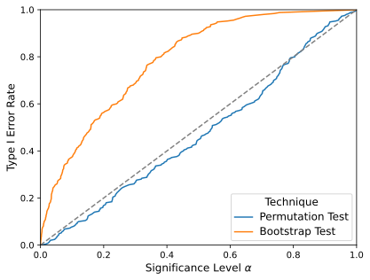

# BI2 Group Project

Replication of:
Pitsch, C., Brockhoff, T., Adams, J. N., Leemans, S. J. J., Celi, L. A., & van der Aalst, W. M. P. (2025). **Hypothesis Testing for Processes.** *2025 7th International Conference on Process Mining (ICPM).* https://doi.org/10.1109/ICPM66919.2025.11220677

## Status
- Fig. 5 (Type I error rate): done, same result as in the paper
- Table II–IV, Fig. 4 and Fig. 6: not started yet

## Setup
The authors' code, in the versions used for the paper. `pcomp` is the method, `pcomp-experiments` contains the scripts for the paper's experiments, and `event_log_mutator` is used by those scripts. [uv](https://docs.astral.sh/uv/getting-started/installation/) and [Rust](https://www.rust-lang.org/tools/install) are needed.

```bash
git clone https://github.com/cpitsch/pcomp
git clone https://github.com/cpitsch/pcomp-experiments
git clone https://github.com/cpitsch/event_log_mutator

cd pcomp && git checkout ICPM25 && uv sync && cd ..
cd pcomp-experiments && git checkout ICPM25 && uv sync && cd ..
cd event_log_mutator && git checkout d2afb17 && cargo build --release && cd ..
```
The three folders need to be next to each other.

## Data
Road Traffic Fine Management Process log (not included in this repository):
https://data.4tu.nl/articles/dataset/Road_Traffic_Fine_Management_Process/12683249/1

Put `Road_Traffic_Fine_Management_Process.xes.gz` into the `pcomp-experiments` folder.

## Fig. 5: Type I error rate
The log is split randomly into two halves 250 times. Both halves come from the same process, so the test should (almost) never report a difference. The paper's method (permutation test) and the older bootstrap test are compared.

How we ran it, inside `pcomp-experiments/road_traffic_random_splits`:
```bash
../../event_log_mutator/target/release/event_log_mutator pipeline road_traffic_random_splits.toml
uv run python run_permutation_cf.py -c 4
uv run python run_bootstrap_cf.py -c 6
uv run python generate_figures.py
```
`-c` is the number of CPU cores. Besides Fig. 5, `generate_figures.py` also tries to plot a time-based variant of this experiment, which is not in the paper and which we did not run. The script therefore stops with a "file not found" error at the end. Fig. 5 (`figures_after/fpr_t1er_cf_combined.pdf`) is created before that.

**Result:** identical to Fig. 5 in the paper. At α = 0.05, the Type I error rate is 0.032 for the permutation test and 0.26 for the bootstrap test.



Raw results (p-value per log pair): [permutation test](results/fig5/permutation_cf_summary.csv), [bootstrap test](results/fig5/bootstrap_cf_summary.csv)

Run on a laptop (8 cores, 16 GB RAM, Ubuntu 20.04): permutation test about 3.5 hours, bootstrap test about 1.5 hours.
